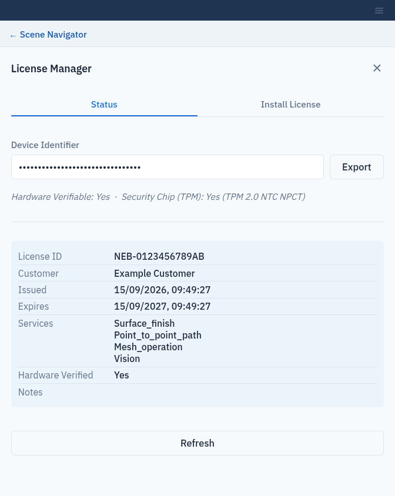

Activate Licenses
=================

Most of Composer Studio works without a license. Three PDK services need a
per-feature license on the **server**, and these Composer Studio features use
them:

.. list-table::
   :header-rows: 1
   :widths: 30 70

   * - License code
     - Composer Studio features
   * - ``point_to_point_path``
     - :doc:`ptp_trajectories`
   * - ``surface_finish``
     - :doc:`paths` and :doc:`linear_path_trajectories`
   * - ``mesh_operation``
     - :doc:`areas` and the mesh filter (:doc:`scene_objects`)

How licenses work
-----------------

* A license is bound to the **TPM 2.0 security chip** of the computer running
  the PDK server. It cannot be copied to another machine.
* Installing a license **takes effect immediately**. No restart is needed.
* Without a license, the features above fail with a message ending in
  ``(code: 5)``; everything else works normally.

Open the License Manager
------------------------

Click the **☰** (**More setup**) button at the top of the left column and
choose **License Manager**. The License Manager does not need a loaded
workcell. The **☰** button is disabled while live scene events are on
(:doc:`live_scene_events`).

Status tab
----------

The **Status** tab shows:

* **Device Identifier**: this server's identifier, which Flexiv needs to issue
  a license.
* **Hardware Verifiable** and **Security Chip (TPM)**: whether the server can
  read its security chip.
* **Warnings**, if the server reports any.
* One block per installed license: **License ID**, **Customer**, **Issued**,
  **Expires**, **Services**, **Hardware Verified** and **Notes**. If there are
  none, it shows **No licenses installed on this computer.**

Click **Refresh** to read the status again.

   The Status tab of the License Manager. The device identifier is hidden here.

Buying and installing a license
-------------------------------

1. On the **Status** tab, click **Export** next to **Device Identifier**. Your
   browser asks where to save ``license_identifier.txt``, or downloads it. Email this file to Flexiv.
2. When Flexiv sends back a ``.lic`` file, open the **Install License** tab.
3. Click **Choose File** and select the ``.lic`` file.
4. Click **Install License**. On success, Composer Studio shows **License
   installed. Newly licensed:** followed by the services' internal names, such
   as ``LICENSED_SERVICE_SURFACE_FINISH``, and returns to the **Status** tab.

The license file is read by your browser and sent to the server, so it can be
on the computer you are browsing from.

You can do the same from a terminal with the ``pdk-scene`` tool:

.. code-block:: bash

   pdk-scene license identifier             # writes license_identifier.txt
   pdk-scene license install -f NEB-2026-0042.lic
   pdk-scene license status
