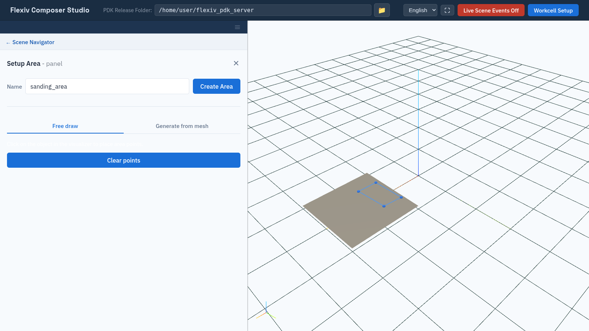

Areas
=====

An **area** is a region cut out of a mesh object, such as the part of a
surface to be sanded. A raster tool path can then be generated to cover it
(:doc:`paths`).

.. note:: Creating an area requires the ``mesh_operation`` license
   (:doc:`activate_licenses`). The lines drawn between the points also need
   the ``surface_finish`` license; without it, the points are shown but not
   joined.

Draw an area
------------

1. In the tree, expand a mesh scene object and click **+** next to **Areas**.
   The object is isolated in the viewport.
2. Enter a **Name**.
3. On the **Free draw** tab, **double-click** on the object to place the
   corners of the area, in order around its outline. Each point is shown as a
   blue sphere, joined to the previous one along the surface. From the third
   point on, a closing line back to the first point is shown.
4. Click **Create Area**. The button shows **Extracting Area...** while the
   server cuts out the region.

   Drawing an area: each double-click places a corner.

The area is listed under the object's **Areas** and highlighted in blue when
selected. Click **Clear points** to start the outline again.

An area needs at least three points to enclose a region. With fewer, **Create
Area** shows **Place at least 3 points on the object to create an area.** If
the server rejects the request, for example for a missing license, Composer
Studio shows **Could not create the area:** followed by the reason. In both
cases the form stays open with your points, so you can fix the problem and
click **Create Area** again.

.. note::

   The **Generate from mesh** tab has no options in this release.

Remove an area
--------------

Click **×** next to the area in the tree. Areas are also removed with their
scene object.
