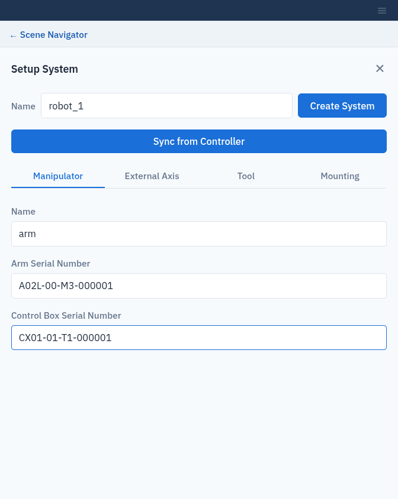
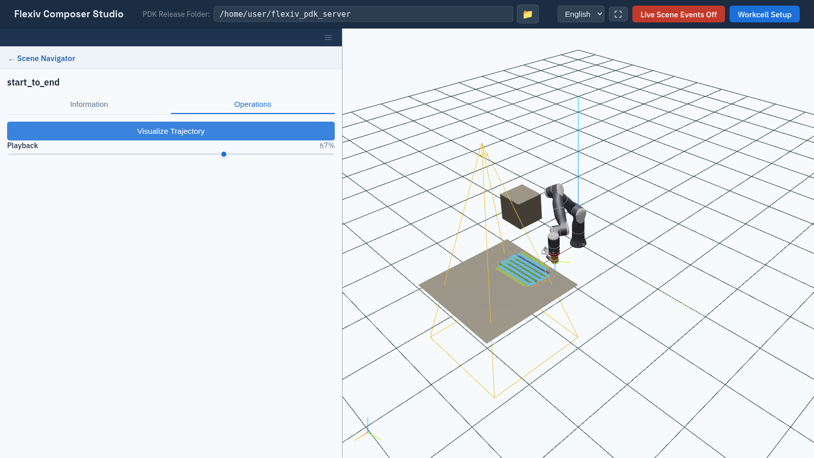

Build Your First Workcell
=========================

This page walks through a first session: it creates a workcell, adds a robot
and a box, saves two robot poses, and plans a point-to-point trajectory between
them. It assumes the PDK server is running and Composer Studio is open in your
browser (:doc:`launch_composer_studio`). Steps 6 and 7 need the
``point_to_point_path`` license (:doc:`activate_licenses`).

Nothing on this page moves a real robot.

Step 1: Check the PDK Release Folder
------------------------------------

Look at **PDK Release Folder:** in the header bar. If the field is red or
Composer Studio reported that the path does not exist, click the folder button
and choose the folder that holds your server's ``workcell/`` directory, then
click **Select This Folder**. See :doc:`launch_composer_studio`.

Step 2: Create and load a workcell
----------------------------------

1. Click **Workcell Setup** in the header bar.
2. Click **New**, enter the **Name** ``quickstart`` and an optional
   **Description**, and click **Create**.
3. ``quickstart`` is now selected in **Available Workcells**. Click **Load**.

The **+** buttons in the **Scene Navigator** become active once a workcell is
loaded.

Step 3: Add a robot system
--------------------------

1. Click **+** next to **Systems**. The **Setup System** form opens.
2. Enter a system **Name**, for example ``robot_1``.
3. On the **Manipulator** tab, fill in **Name** (for example ``arm``),
   **Arm Serial Number** and **Control Box Serial Number**. Use the serial
   numbers of your robot.
4. Click **Create System**.

The robot appears in the viewport at the world origin. If the robot is
connected to the network, you can fill in the form from the robot instead with
**Sync from Controller**; see :doc:`systems`.

   The Setup System form.

Step 4: Add a box
-----------------

1. Click **← Scene Navigator** to return to the tree, then click **+** next to
   **Scene Objects**.
2. Enter the **Name** ``box_1`` and open the **Primitive Shapes** tab.
3. Leave the size at 0.1 m, and set the pose **X** to ``0.5``. A blue
   wireframe preview shows where the box will go.
4. Click **Insert**.

Step 5: Save two targets
------------------------

A *target* is a saved robot pose.

1. In the tree, click **+** next to **Targets** under **robot_1**.
2. Enter the **Name** ``start``. On the **Joint Space** tab, move a few joint
   sliders. If the pose is in collision or out of reach, Composer Studio shows
   an error.
3. Click **Create Target**.
4. Repeat with the name ``end`` and a different pose.

Step 6: Plan a PTP trajectory
-----------------------------

1. Click **+** next to **PTP Trajectories** under **robot_1**.
2. Enter the **Name** ``start_to_end``.
3. In **Available Targets**, select ``start`` and click **→**, then do the same
   for ``end``.
4. Click **Create Trajectory**. The button shows **Solving…** while the server
   plans a collision-free motion.

Step 7: Play it back
--------------------

1. Under **robot_1**, click ▶ next to **PTP Trajectories**, click
   ``start_to_end`` and open the **Operations** tab.
2. Click **Visualize Trajectory**. The robot in the viewport moves from
   ``start`` to ``end``. Drag the **Playback** slider to scrub through the
   motion.

   The finished PTP trajectory, played back in the viewport.

Next steps
----------

* Take the tour in :doc:`interface_overview`.
* Import a mesh and draw a tool path on it: :doc:`scene_objects`,
  :doc:`areas` and :doc:`paths`.
* Check what you built from a terminal:

  .. code-block:: bash

     pdk-scene workcell list
     pdk-scene object list
