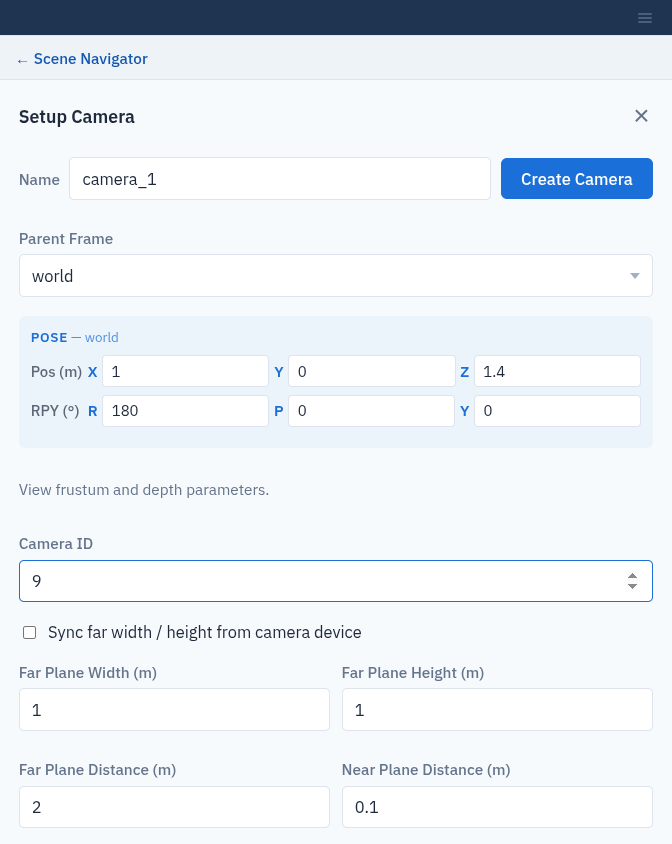
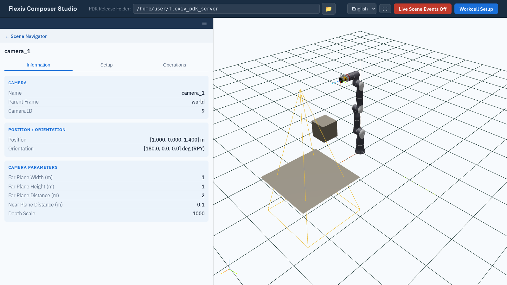

Cameras
=======

A camera in the workcell describes where a 3D camera is mounted and what it
sees. Composer Studio draws it as an orange wireframe pyramid, the camera's
*view frustum*.

Add a camera
------------

Click **+** next to **Cameras**, fill in the form and click **Create Camera**.

.. list-table::
   :header-rows: 1
   :widths: 32 16 52

   * - Field
     - Default
     - Meaning
   * - **Name**
     - (required)
     - Unique camera name.
   * - **Parent Frame**
     - world
     - **world** for a fixed camera, or a robot flange for a camera on the arm.
   * - **Pose**
     - 0
     - Position (m) and orientation (RPY, degrees) relative to the parent.
   * - **Camera ID**
     - (required)
     - The camera's ID on the camera system it belongs to.
   * - **Far Plane Width (m)**, **Far Plane Height (m)**
     - 1, 1
     - Size of the view at the far plane.
   * - **Far Plane Distance (m)**
     - 2
     - Furthest distance the camera sees.
   * - **Near Plane Distance (m)**
     - 0.1
     - Nearest distance the camera sees.
   * - **Depth Scale**
     - 1000
     - Factor that converts the camera's depth values to metres.

All fields except the parent and pose are required. If one is empty,
Composer Studio shows **Please fill in the required fields:** followed by the
missing fields.

   Setup Camera.

Read the view size from the camera
----------------------------------

Tick **Sync far width / height from camera device** to have the far plane
width and height read from the real camera after the camera is saved. While
it is ticked, **Far Plane Width (m)** and **Far Plane Height (m)** cannot be
edited. The camera must be online. If it is not, the camera is saved with the values you
entered and Composer Studio warns:

.. code-block:: text

   Camera "<name>" is not online — far width/height could not be synced.

View, edit or delete a camera
-----------------------------

Select the camera in the tree. **Information** shows its parent, ID, pose and
parameters. **Setup** has the edit form, with **Modify Camera** and **Delete
Camera**. **Operations** has no operations for cameras.

Keep the camera **Name** unchanged when you modify a camera. Modify Camera with
a new **Name** saves a second camera under that name and leaves the old one in
place. To rename a camera, delete it and create it again.

Capturing images and point clouds is not available in Composer
Studio; use the PDK directly (see the PDK manual's *Cameras and Reconstruction*
page).

   A camera above the work part, drawn as its view frustum.
