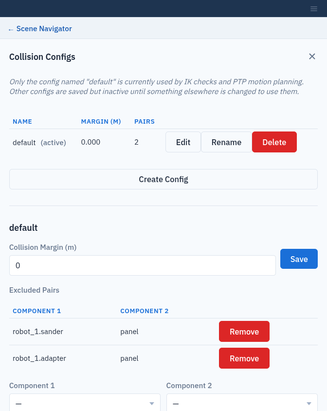

Collision Configurations
========================

A **collision configuration** sets how strictly the server checks for
collisions: a **margin** (the minimum allowed distance between parts) and a
list of **excluded pairs** (parts allowed to touch, such as a tool and the part
it is working on).

.. important::

   Only the configuration named ``default`` is used: by the collision check
   when you pose a robot (:doc:`targets`) and by PTP planning
   (:doc:`ptp_trajectories`). Other configurations are saved but not used.

Open the editor with **☰** (**More setup**) → **Collision Configs**. The
table lists each configuration's **Name**, **Margin (m)** and number of
**Pairs**. ``default`` is marked **(active)**.

Create a configuration
----------------------

Click **Create Config**, enter a **Name** and click **Create Config** again.
New configurations start with a margin of 0 and no excluded pairs.

Use a name that is not already taken. Creating a configuration with an
existing name, including ``default``, replaces it with an empty one: its
margin and excluded pairs are lost.

Edit a configuration
--------------------

Click **Edit** in the configuration's row.

* **Collision Margin (m)**: enter the margin and click **Save**.
* **Excluded Pairs**: choose **Component 1** and **Component 2** from the
  lists of collision parts in the workcell, and click **Add Pair**. Click
  **Remove** on a row to check that pair again.

.. warning::

   Composer Studio overwrites the margin of ``default``, keeping its excluded
   pairs:

   * adding a system or a scene object sets it to 0;
   * creating a PTP trajectory sets it to that trajectory's **Collision
     Margin**, 0 by default (:doc:`ptp_trajectories`).

   Check the margin of ``default`` after these steps and set it again if
   needed.

   The default configuration, with the sander and its adapter allowed to touch the part.

Rename or delete a configuration
--------------------------------

Use **Rename** or **Delete** in the configuration's row. Composer Studio warns
before you rename or delete ``default``: afterwards, collision checks run with
an empty configuration (no margin, no excluded pairs) until a new ``default``
exists. Adding a system or a scene object, or creating a PTP trajectory,
creates a new empty ``default`` automatically.
