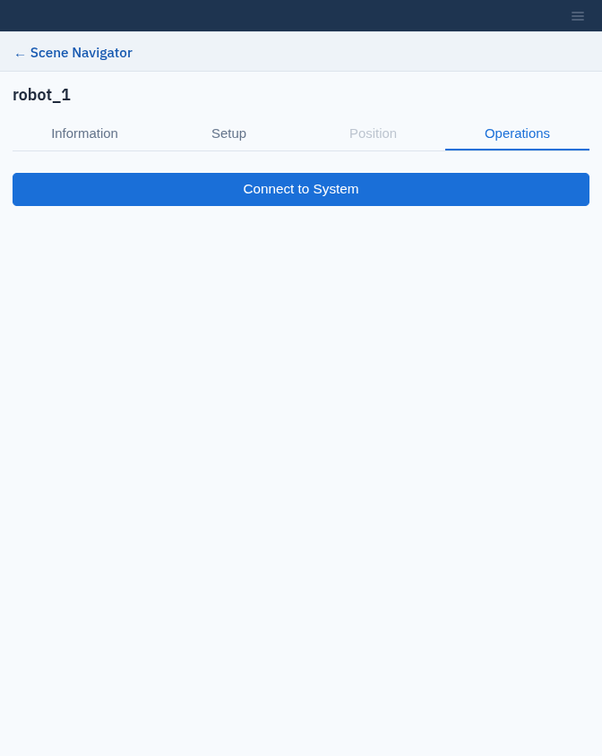

Connect to a Real Robot
=======================

A system in the workcell can be connected to the real Flexiv robot it
describes. While connected, the robot in the viewport follows the real robot's
joint angles and TCP pose.

.. important::

   **Connecting enables the robot.** When you click **Connect to System**,
   Composer Studio clears any robot fault, checks the mounted tool, then
   **enables** the robot (releases the brakes and powers the motors),
   switches it to idle mode, and releases the external-axis lock. Before
   connecting:

   * make sure nobody is inside the robot's workspace;
   * keep the emergency stop within reach;
   * follow **all safety instructions** in the documents shipped with the
     robot.

   Composer Studio sends **no motion commands** in this release, but the robot
   stays enabled after connecting, and after you disconnect.

Before you connect
------------------

* The robot and its control box are switched on and on the same network as
  this computer, with RDK remote mode enabled in the robot's settings. The
  robot runs Flexiv software package v3.11.3, the version the bundled
  ``flexivrdk`` supports.
* The system was set up with the robot's serial number, for example with
  **Sync from Controller** (:doc:`systems`).
* If the system has a tool, the tool mounted on the real robot has the same
  name. Composer Studio compares the system's tool **Name** with the name of
  the tool selected on the robot's controller, and refuses to connect if they
  differ. This check runs before the robot is enabled, so a mismatch leaves
  the robot as it was. The manufacturer and model are not compared.

Connect
-------

1. Select the system in the tree and open the **Operations** tab.
2. Click **Connect to System**. The button shows **Connecting…**, for up to
   about 10 seconds while the robot becomes operational.

   The Operations tab of a system.

When the connection succeeds:

* the dot next to the system in the tree shows it is connected;
* the robot in the viewport follows the real robot, updating about ten times
  a second;
* a small axes frame marks the real TCP;
* the **Position** tab becomes available.

If the connection fails, Composer Studio shows **Failed to connect to
system:** followed by the reason:

.. list-table::
   :header-rows: 1
   :widths: 45 55

   * - Message
     - What to do
   * - ``Connection failed: <reason>``
     - The robot could not be reached, refused the connection, or failed to
       switch to idle mode. Check its network, its serial number and that RDK
       remote mode is enabled. If the robot had already been enabled,
       Composer Studio stops it.
   * - ``Robot fault could not be cleared.``
     - Check the robot for the cause of the fault, clear it on the robot, then
       try again. The robot is not enabled.
   * - ``Timed out waiting for robot to become operational.``
     - Check that the emergency stop is released and the robot is in remote
       mode. The robot has already been enabled at this point; Composer Studio
       stops it.
   * - ``Could not read mounted tool name: <reason>``
     - Check the tool settings on the robot, then try again. The robot is not
       enabled.
   * - ``Tool mismatch: hardware has '<a>' mounted, but system '<s>' is configured for tool '<b>'.``
     - Select the mounted tool on the robot, or change the system's tool
       **Name** to match it (:doc:`systems`). The robot is not enabled.
   * - ``No serial number available for system '<s>'.``
     - Set the system's **Arm Serial Number**.

Position tab
------------

The **Position** tab has a **Joint Space** tab with joint sliders and a
**Cartesian Space** tab with a TCP pose editor, as in :doc:`targets`.

.. note::

   **Preview only — jogging the live robot is not yet wired up.** The
   controls move the robot in the viewport only; the real robot does not move.

While you are editing a target or trajectory of a connected system, or one of
them is selected, the viewport shows that pose instead of the live robot.

Disconnect
----------

While a system is connected, its **Operations** tab shows **Disconnect from
System** in place of **Connect to System**. Click it to close the connection:
the dot in the tree shows the system as disconnected, the robot in the viewport
stops following the real robot, the TCP axes frame disappears and the
**Position** tab is no longer available.

Composer Studio also disconnects every robot whenever the workcell is loaded,
including the reloads that live scene events make (:doc:`live_scene_events`),
and a system's robot when you delete the system.

Disconnecting does not move the robot or change its state: it stays enabled
and in idle mode. Disable the robot from its own controls when you are
finished.
