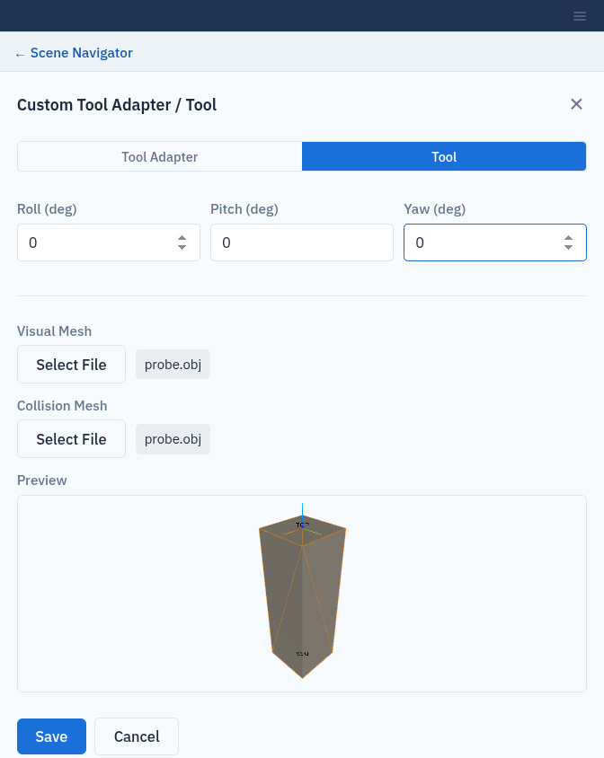

Custom Components
=================

When your tool or tool adapter is not in the server's component catalogue,
define it as a **custom component**. Custom components then appear in the
**Manufacturer** and **Model** lists of the **Tool** tab when you set up a
system (:doc:`systems`).

Open the editor with **☰** (**More setup**) → **Custom Components**. It has
two tabs, **Tool Adapter** and **Tool**, each listing the saved components
with their **Manufacturer** and **Model**.

Add a tool adapter
------------------

A tool adapter sits between the robot flange and the tool. It has one or more
*flanges* where a tool can be mounted.

1. On the **Tool Adapter** tab, click **Add Tool Adapter**.
2. Enter the **Manufacturer** (for example ``Flexiv``) and **Model**.
3. Under **Flange Pose**, enter the pose of the tool-side flange relative to
   the robot flange: **X (m)**, **Y (m)**, **Z (m)**, **Roll (deg)**,
   **Pitch (deg)**, **Yaw (deg)**. Click **Add Flange** for each further
   flange. With more than one flange, click **Remove Flange** to delete one.
4. Under **Visual Mesh** and **Collision Mesh**, click **Select File** and
   choose the ``.obj`` or ``.stl`` files. The collision mesh is used as its
   convex hull, so a concave shape is checked as if it were filled in.
5. Check the **Preview** and click **Save**.

Add a tool
----------

The **Tool** tab works the same way, using **Add Tool**, except that a tool has a single **TCP
Pose** (tool centre point) instead of flange poses.

The preview
-----------

The preview is a small 3D view you can orbit, zoom and pan. It draws:

* the visual mesh;
* the collision mesh, as an orange see-through wireframe;
* the world frame;
* one labelled frame per pose: **Flange 1**, **Flange 2** and so on, or
  **TCP**.

Use it to check that the poses sit where the mesh expects them.

   A custom tool with its TCP frame shown in the preview.

Edit or remove a component
--------------------------

* **To edit**, save a new entry with the same **Manufacturer** and **Model**.
  It replaces the old one. The form opens empty, so enter all poses again and
  select both mesh files again: a mesh you do not select is saved as empty.
* **To remove**, click **Remove** in the list. If a system uses the component,
  Composer Studio names the systems and asks you to confirm.

**Manufacturer** and **Model** are required (**Please specify a manufacturer
and model.**). Mesh files are copied to the PDK Release Folder as
``custom_components/tools/<Manufacturer>_<Model>/`` or
``custom_components/tool_adapters/<Manufacturer>_<Model>/``, renamed to
``visual`` and ``collision`` with their original extension.
