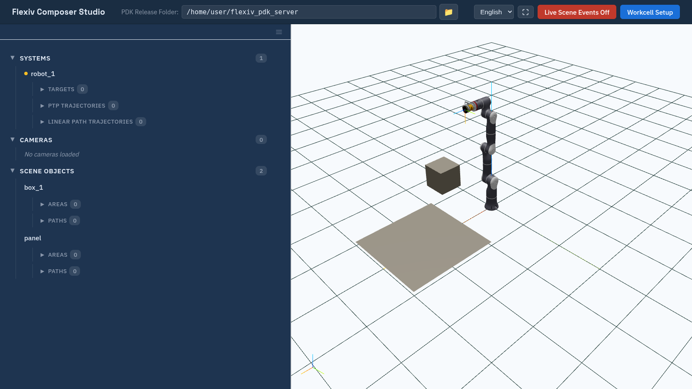

Interface Overview
==================

Layout
------

   Composer Studio with a workcell loaded: the Scene Navigator on the left, the 3D viewport on the right.

The header bar runs across the top. Below it, the left column holds the
**Scene Navigator** tree or the details of the selected item, and the right
column holds the 3D viewport.

Header bar
----------

.. list-table::
   :header-rows: 1
   :widths: 30 70

   * - Control
     - Use
   * - **PDK Release Folder:**
     - The folder holding the server's workcell files. Type a path and press
       :kbd:`Enter`, or click the folder button to browse. See
       :doc:`launch_composer_studio`.
   * - Language
     - **English** or **中文**. The choice resets to English when you reload
       the page.
   * - Full screen
     - Enter or exit browser full screen.
   * - **Live Scene Events Off** / **On**
     - Follow changes made to the scene by other programs.
       See :doc:`live_scene_events`.
   * - **Workcell Setup**
     - Create, load and delete workcells. See :doc:`workcells`.

Left column
-----------

The left column shows either the **Scene Navigator** tree or the details of
one item, never both.

* Click an item in the tree to open its details. Click **← Scene Navigator** at
  the top to go back.
* The **☰** (**More setup**) button opens workcell-wide tools:
  **Collision Configs** (:doc:`collision_configs`), **Custom Components**
  (:doc:`custom_components`) and **License Manager** (:doc:`activate_licenses`).
  It is disabled while live scene events are on (:doc:`live_scene_events`).
* Drag the bar between the two columns to resize them.

Scene Navigator
---------------

The tree has three categories. Items inside them have their own
sub-categories:

.. code-block:: text

   Systems
     └─ <system>            ● connection status
          ├─ Targets
          ├─ PTP Trajectories
          └─ Linear Path Trajectories
   Cameras
     └─ <camera>
   Scene Objects
     └─ <mesh object>
          ├─ Areas
          └─ Paths

* Click ▶ to expand a category. The number next to it is its item count.
* Click **+** on a category to add an item to it. The **+** buttons are
  disabled until a workcell is loaded.
* Click **×** (**Remove**) on an item to delete it, after confirming. Systems
  and cameras have no **×**; delete them from their **Setup** tab.
* **Double-click** a scene object or camera to *isolate* it: everything else
  is hidden from the viewport. Everything is shown again when you close a
  setup form or load the workcell again; going back with **← Scene
  Navigator** from an item's details does not show it.
* Areas and paths are drawn on the surface of a mesh object; see
  :doc:`areas` and :doc:`paths`.

The tree is locked while you are drawing an area or sketching a path, and
while live scene events are on.

Details panel
-------------

Each item's details are split into tabs, such as **Information**, **Setup**,
**Position** and **Operations**. Which tabs appear depends on the item type,
and each is described on that item's page.

Viewport
--------

The viewport shows the workcell in 3D, with Z up, a 10 m × 10 m floor grid
with 0.5 m squares, and the world axes at the origin (X red, Y green, Z blue).

.. list-table:: Mouse controls
   :header-rows: 1
   :widths: 30 70

   * - Action
     - Result
   * - Left-drag
     - Orbit around the scene.
   * - Right-drag
     - Pan.
   * - Wheel
     - Zoom (1 m to 30 m from the focus point).
   * - Double-click on an object
     - Place a point, only while drawing an area or sketching a path.
   * - Right-click
     - Choose the TCP drag mode, only while dragging a TCP (:doc:`targets`).

Clicking an object in the viewport does **not** select it; select items in the
tree. The small axes in the bottom-left corner show which way the view faces.

What the viewport draws:

* Robots, scene objects and areas, at their poses.
* Cameras as orange wireframe pyramids, showing their field of view.
* Paths as a line with a small axes frame at each pose, shown when the path is
  selected.
* A small axes frame at the TCP of each robot that is connected
  (:doc:`connect_to_robot`).
* The selected area, camera or path highlighted in blue.

Messages
--------

Short messages appear at the top of the window and close after a few seconds:
✓ success, ✕ error, ⚠ warning, ℹ information. Click a message to close it
early. Questions that need an answer, such as delete confirmations, open as a
dialog with **Cancel** and **OK**.
