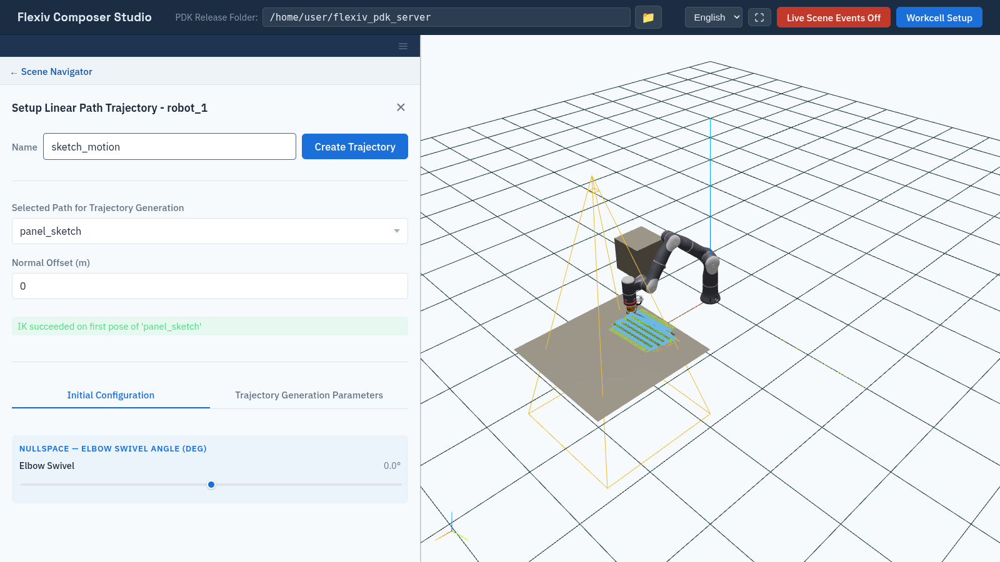
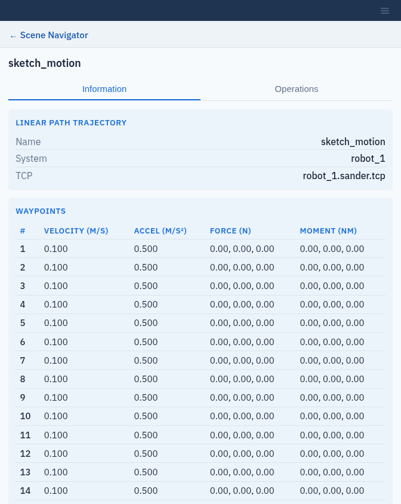

Linear Path Trajectories
========================

A **linear path trajectory** is robot motion that moves a system's TCP along
a tool path (:doc:`paths`), with a set velocity and acceleration, and the
force and moment the tool should apply.

.. note:: Linear path trajectories require the ``surface_finish`` license
   (:doc:`activate_licenses`).

Create a linear path trajectory
-------------------------------

1. In the tree, expand the system and click **+** next to **Linear Path
   Trajectories**.
2. Enter a **Name**.
3. Under **Selected Path for Trajectory Generation**, choose the path. It is
   drawn and highlighted in the viewport.
4. If needed, set **Normal Offset (m)** (0 to 0.020 m, default 0). The
   path's refined poses are moved this distance along the negative Z axis of
   each pose. The nominal poses, which **Information** lists, are not moved.
5. Set the robot's starting configuration and the motion parameters on the two
   tabs below.
6. When the reachability check succeeds, click **Create Trajectory**. The
   button shows **Solving…** while the server computes the motion.

Reachability check
------------------

Composer Studio checks that the robot can reach the **first pose** of the
path, and shows the result under the path selection:

* ``IK succeeded on first pose of '<path>'``: the robot is shown at the first
  pose, and **Create Trajectory** is enabled.
* ``IK failed on first pose of '<path>': ...``, followed by the server's
  message, such as ``IK solver failed to find a solution (code: 3)``: the
  first pose is out of reach with the current settings. Change the initial configuration,
  move the part or the robot, or choose another path.

The check runs again whenever you change the offset, the elbow swivel or the
external axis settings. **Create Trajectory** stays disabled until it
succeeds.

   The reachability check has succeeded, so Create Trajectory is enabled.

Initial Configuration tab
-------------------------

Sets how the robot reaches the first pose. These are the same
**Elbow Swivel** and external axis (**Preferred** / **Preset**) controls as in
:doc:`targets`.

Trajectory Generation Parameters tab
------------------------------------

.. list-table::
   :header-rows: 1
   :widths: 30 20 50

   * - Field
     - Default
     - Meaning
   * - **Force (N)** X, Y, Z
     - 0
     - Force the tool applies along the path.
   * - **Moment (Nm)** X, Y, Z
     - 0
     - Moment the tool applies along the path.
   * - **Velocity**
     - 0.1 m/s
     - TCP velocity along the path.
   * - **Acceleration**
     - 0.5 m/s²
     - TCP acceleration along the path.

View and play back
------------------

Select the trajectory in the tree.

* **Information** lists the **System**, the **TCP**, and a **Waypoints** table
  with each waypoint's **Velocity (m/s)**, **Accel (m/s²)**, **Force (N)** and
  **Moment (Nm)**.
* **Operations** has the same **Visualize Trajectory**, **Stop** and
  **Playback** controls as PTP trajectories (:doc:`ptp_trajectories`).
  Playback uses each waypoint's velocity.

   The waypoints of a linear path trajectory.

To delete a trajectory, click **×** next to it in the tree.
