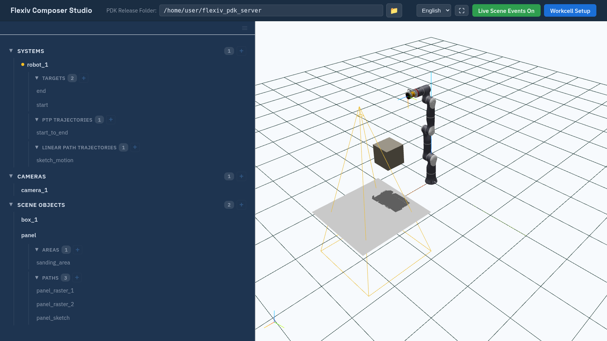

Live Scene Events
=================

Other programs can change the workcell while Composer Studio is open: your own
PDK application, the ``pdk-scene`` tool, or a second Composer Studio window.
**Live Scene Events** makes the viewport follow those changes as they happen,
for example to watch an application add and move parts.

Turn it on
----------

Click **Live Scene Events Off** (red) in the header bar and confirm. The
button turns green and reads **Live Scene Events On**. Composer Studio reloads the current
workcell, then follows changes from the server.

While it is on, **the editor is read-only**: open forms and details close,
and the tree, its **+** and **×** buttons and the **☰** menu are disabled. You
can still orbit and zoom the viewport. **Workcell Setup** stays available, so
**Load** and **Delete** still work.

   Live scene events on: the editor is read-only.

Click **Live Scene Events On** to turn it off and edit again.

What is followed
----------------

.. list-table::
   :header-rows: 1
   :widths: 40 60

   * - Change on the server
     - Shown in Composer Studio
   * - Scene object added, removed, renamed or moved
     - Immediately.
   * - Workcell reloaded or replaced
     - Composer Studio reloads the workcell it is showing. If another program
       loads a different workcell, Composer Studio makes its own workcell
       active again instead of following the new one.
   * - Systems, cameras, paths, targets, trajectories
     - Not followed. Load the workcell again to see them
       (:doc:`workcells`).

If the connection to the server drops, Composer Studio reconnects
automatically after about two seconds.

.. note::

   Added scene objects are always read as ``.obj`` meshes, so an object added
   with an ``.stl`` mesh is not drawn. Their parent is also ignored: an object
   attached to a flange is drawn as if attached to **world**. Load the
   workcell again to see them correctly.

Example
-------

With live scene events on, move a scene object from a terminal and watch it
move in the viewport. List the objects, then move one by name to a position in
metres:

.. code-block:: bash

   pdk-scene object list
   pdk-scene object move <name> --pos 0.5 0.1 0.3
   pdk-scene object --help
