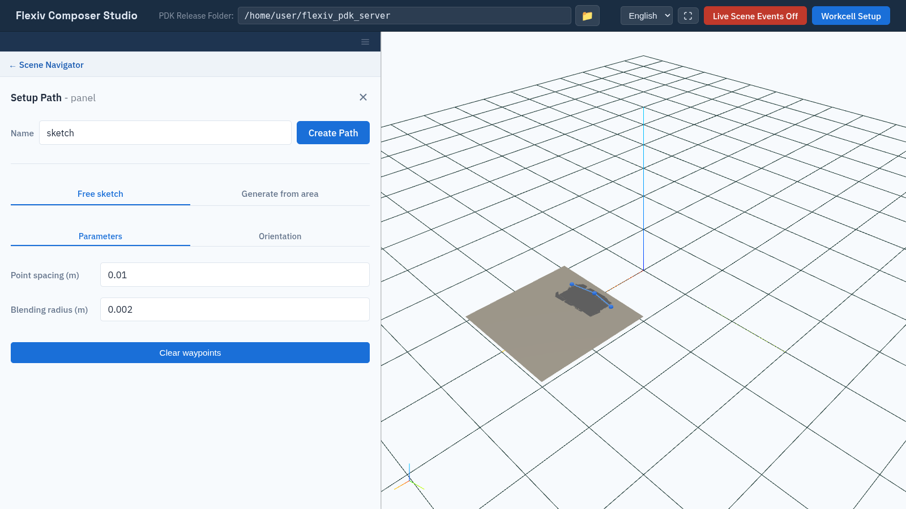
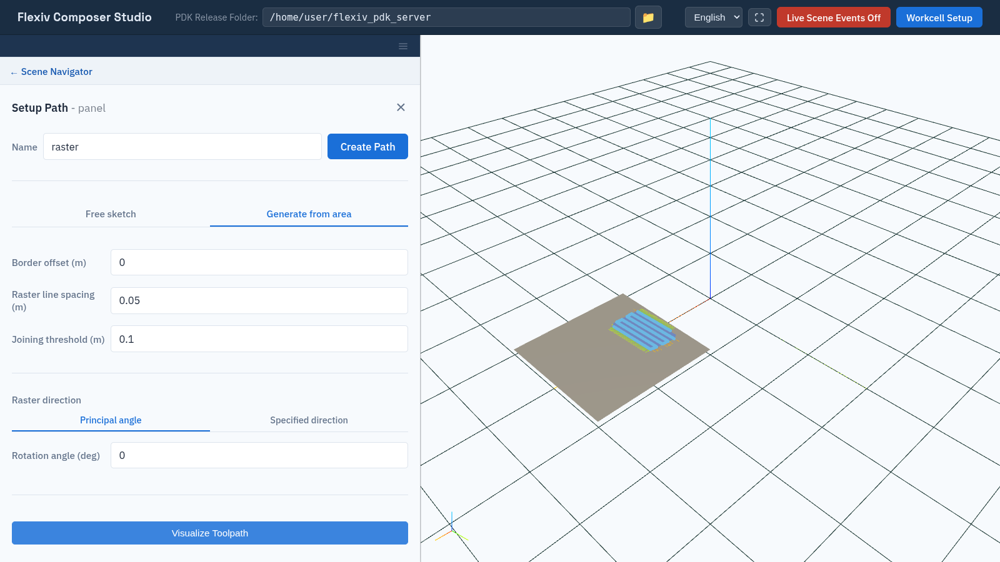

Tool Paths
==========

A **path** is a sequence of tool poses on the surface of a mesh object, such
as the line a sanding tool follows. Each pose has a position on the surface
and an orientation. A path on its own is not
robot motion; turn it into motion with a linear path trajectory
(:doc:`linear_path_trajectories`).

.. note:: Creating a path requires the ``surface_finish`` license
   (:doc:`activate_licenses`).

Create a path
-------------

In the tree, expand a mesh scene object and click **+** next to **Paths**.
The object is isolated in the viewport. Enter a **Name**, build the path on
one of the two tabs, and click **Create Path**.

Composer Studio saves the path as ``<object>_<name>``: a path named ``pass1``
on ``panel`` is saved as ``panel_pass1``. Path names must not repeat a path or
trajectory name in the workcell. Composer Studio checks this only on the
**Free sketch** tab.

On the **Free sketch** tab, a path needs at least two waypoints. With fewer,
**Create Path** shows **Place at least 2 waypoints on the object to create a
path.** If the server rejects the request on either tab, for example for a
missing license, Composer Studio shows **Could not create the path:** followed
by the reason. In both cases the form stays open with your settings and
waypoints, so you can fix the problem and click **Create Path** again.

Free sketch tab
---------------

Draw the path by hand.

1. **Double-click** on the object to place waypoints, in order. Blue markers
   show the waypoints, and the generated path between them is drawn along the
   surface.
2. Adjust the **Parameters**:

   .. list-table::
      :header-rows: 1
      :widths: 30 15 55

      * - Field
        - Default
        - Meaning
      * - **Point spacing (m)**
        - 0.01
        - Distance between poses along the path.
      * - **Blending radius (m)**
        - 0.002
        - Radius used to round the corners at waypoints.

3. Choose the **Orientation** (see below).
4. Click **Create Path**.

At least two waypoints are needed. Click **Clear waypoints** to start again.

   Sketching a path with three waypoints.

Generate from area tab
----------------------

Generate a raster (zig-zag) path that covers an area (:doc:`areas`).

1. Choose the **Area**. It is highlighted in the viewport.
2. Adjust the **Parameters**:

   .. list-table::
      :header-rows: 1
      :widths: 30 15 55

      * - Field
        - Default
        - Meaning
      * - **Fixed spacing (m)**
        - 0.01
        - Distance between poses along each line.
      * - **Blending radius (m)**
        - 0.002
        - Radius used to round the turns.
      * - **Border offset (m)**
        - 0.0
        - Distance to keep from the edge of the area.
      * - **Raster line spacing (m)**
        - 0.05
        - Distance between neighbouring raster lines.
      * - **Joining threshold (m)**
        - 0.1
        - Raster segments whose ends are closer than this are joined into one
          pass. Must be at least twice the raster line spacing; Composer Studio
          raises it if it is smaller.
      * - **Raster direction**
        - **Principal angle**
        - **Principal angle**: lines follow the area's principal direction,
          turned by **Rotation angle (deg)** (−90 to 90).
          **Specified direction**: lines follow the X, Y, Z direction you
          enter in the world frame, projected onto the mesh.

3. Choose the **Orientation** (see below).
4. Click **Visualize Toolpath** to preview the path. The preview is not saved
   on the server, but its paths are listed under **Paths** until you create
   the path or close the form.
5. Click **Create Path**. One area can produce several paths, one per
   separate pass, each listed under **Paths**.

   A raster path previewed with Visualize Toolpath.

Orientation
-----------

**Orientation alignment** sets which way the X axis of each pose points:

* **Align with initial direction** (default): roughly along the direction
  from the first to the second waypoint, for every pose.
* **Align with previous waypoint**: roughly along the path, following it as
  it turns.
* **Align with direction in world**: roughly along the **X**, **Y**, **Z**
  direction you enter, in the world frame.

Rotate a path
-------------

Select a path in the tree and open **Operations**. Click **Rotate Path Poses
about its Z-axis**, drag the slider (−180° to 180°) while watching the
preview, and click **Apply Changes**. This turns every pose about its own Z
axis, for example to clear a tool cable.

Selecting a path shows it in the viewport as a line with a small axes frame at
each pose. To delete it, click **×** next to it in the tree.
