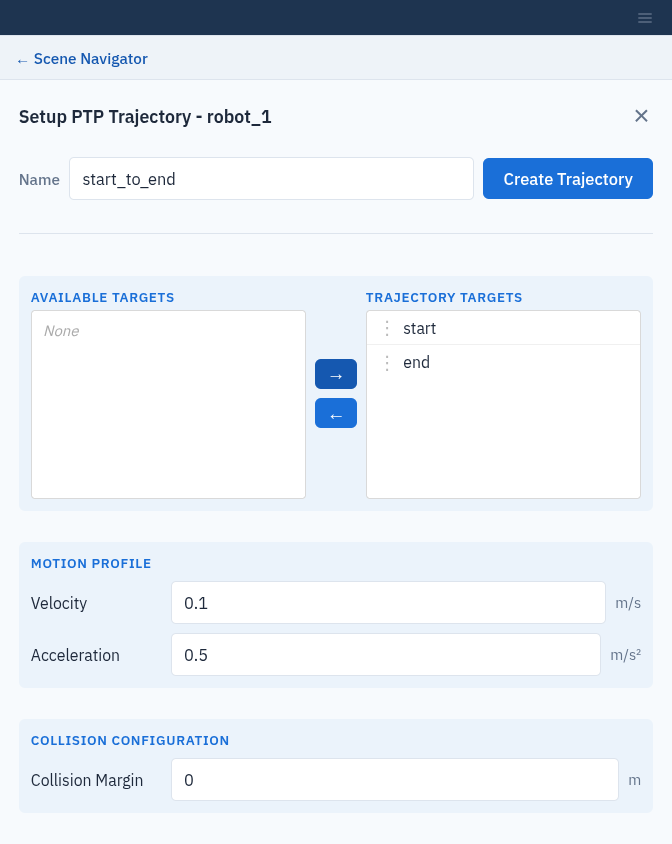

PTP Trajectories
================

A **PTP (point-to-point) trajectory** is collision-free robot motion through a
list of targets (:doc:`targets`). The server plans the motion between each
pair of targets, avoiding the objects in the workcell.

.. note:: PTP trajectories require the ``point_to_point_path`` license
   (:doc:`activate_licenses`).

Create a PTP trajectory
-----------------------

1. Create at least two targets for the system.
2. In the tree, expand the system and click **+** next to **PTP
   Trajectories**.
3. Enter a **Name**.
4. Build the target list:

   * Select a target in **Available Targets** and click **→** to add it to
     **Trajectory Targets**. Click **←** to take it out again.
     **Available Targets** lists the targets of every system in the workcell.
     Choose only this system's targets; another system's joint angles are
     applied to this robot as they are.
   * Drag targets by their **⋮** handle to change the order. The robot visits
     them from top to bottom.
   * Click any target to show that pose in the viewport.

5. Set the **Motion Profile** and **Collision Configuration**:

   .. list-table::
      :header-rows: 1
      :widths: 30 20 50

      * - Field
        - Default
        - Meaning
      * - **Velocity**
        - 0.1 m/s
        - TCP velocity, saved with the trajectory.
      * - **Acceleration**
        - 0.5 m/s²
        - TCP acceleration, saved with the trajectory.
      * - **Collision Margin**
        - 0 m
        - Minimum distance to keep from obstacles while planning.

6. Click **Create Trajectory**. The button shows **Solving…** while the server
   plans. If planning fails, for example because a target is unreachable,
   Composer Studio shows the server's message.

   Choosing the targets of a PTP trajectory.

.. important::

   **Collision Margin** is written into the ``default`` collision
   configuration (:doc:`collision_configs`), so it also applies to every later
   collision check in the workcell. It is written even if planning then
   fails. Because the field starts at 0 m, creating a trajectory without
   changing it resets the margin of ``default`` to 0.

Play back a trajectory
----------------------

Select the trajectory in the tree and open **Operations**:

* **Visualize Trajectory** plays the motion on the robot in the viewport.
  Click **Stop** to pause.
* Drag the **Playback** slider to jump to any point. Dragging stops playback;
  click **Visualize Trajectory** to play on from there.

Playback runs at a fixed display speed, not at the planned velocity.

.. figure:: _static/images/ptp_playback.png
   :width: 100%
   :alt: Playing back a PTP trajectory.

   Playing back a PTP trajectory.

To delete a trajectory, click **×** next to it in the tree.
