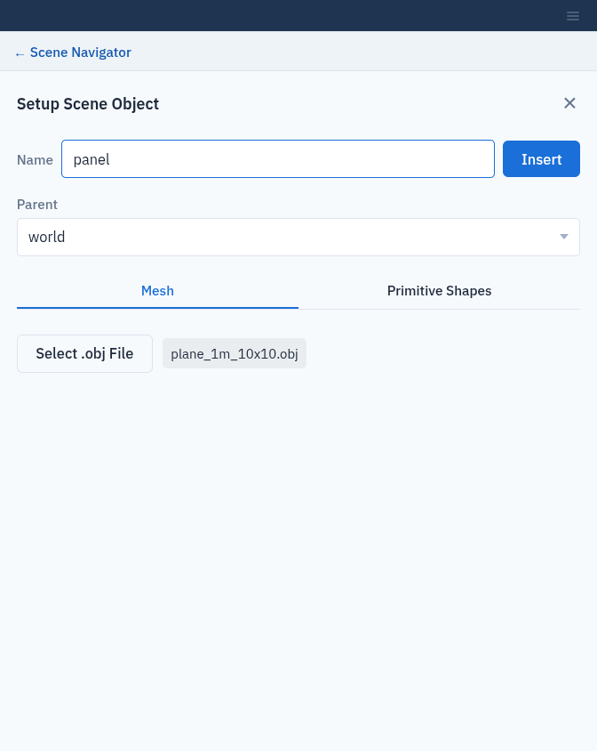
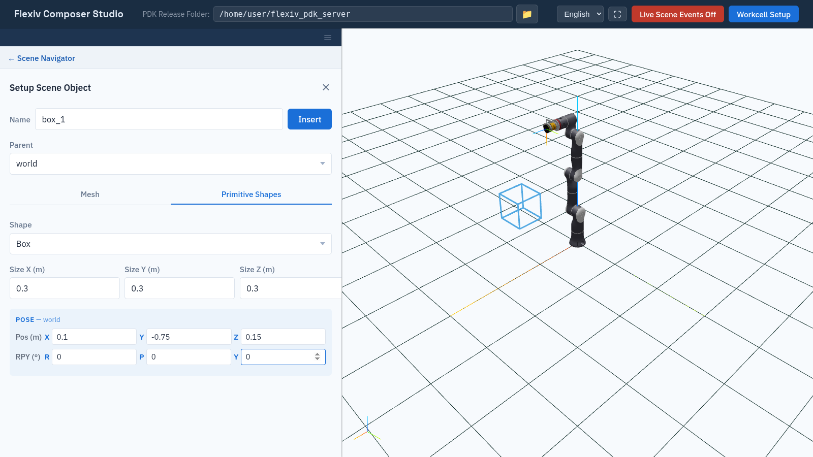
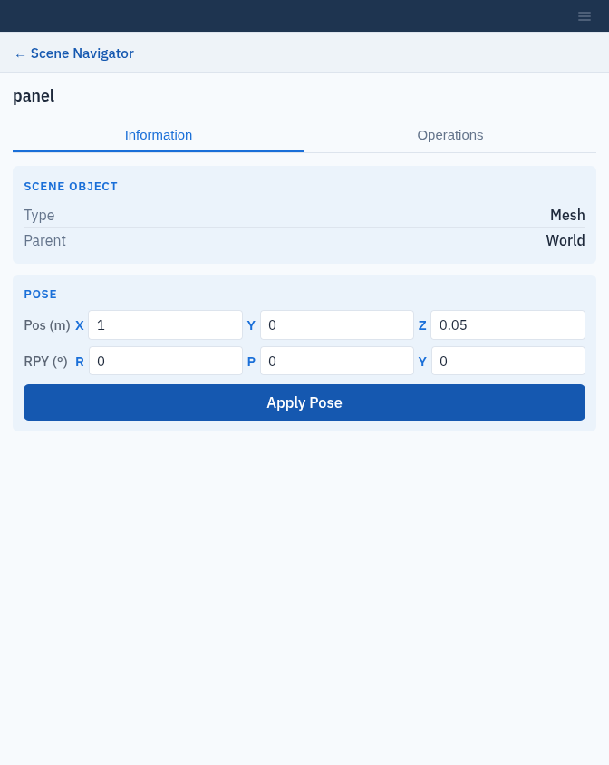
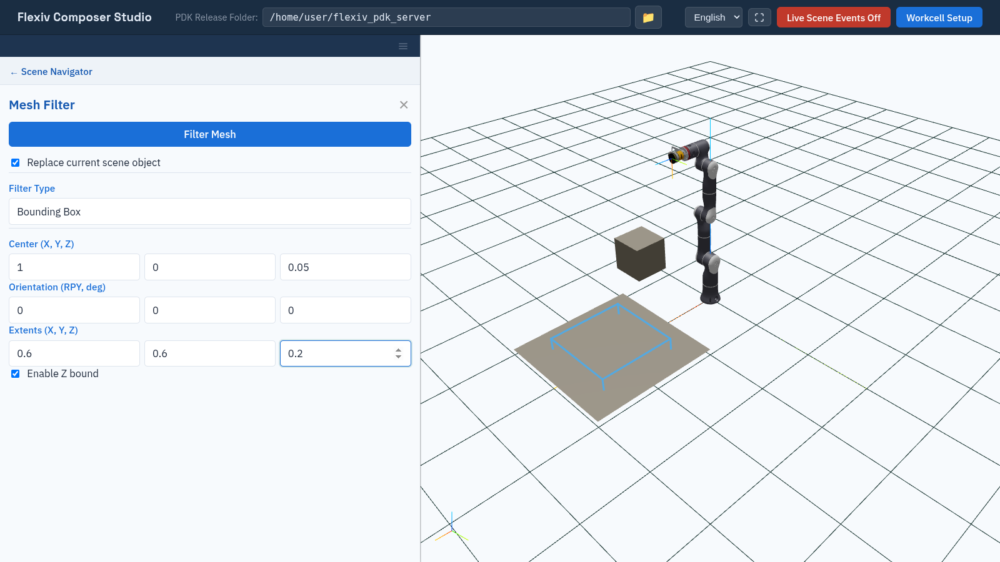

Scene Objects
=============

Scene objects are the parts, fixtures and obstacles in the workcell. They take
part in collision checking, and mesh objects can carry areas and tool paths.

Add a scene object
------------------

Click **+** next to **Scene Objects**. Enter a **Name** and choose a
**Parent**:

* **world**: the object stays fixed in the workcell.
* *system (flange)*: the object is attached to that robot's flange and moves
  with it, for example a part held by a gripper.

Then use one of the two tabs and click **Insert**.

Use a name that is not already taken. Composer Studio does not check for
duplicates: inserting an object with an existing name replaces that object's
mesh and pose.

Mesh tab
   Click **Select .obj File** and choose a Wavefront ``.obj`` file. If the
   **Name** is empty, it is filled in from the file name. If the ``.obj`` file
   uses a material file, a **Required .mtl file** row appears; click **Select
   .mtl File** and choose it. **Insert** works without it, but the mesh then
   has no material. Only ``.obj`` meshes are supported. Mesh coordinates are
   read in metres. The mesh is inserted at the parent's origin; move it
   afterwards on its **Information** tab (`Move a scene object`_).

Primitive Shapes tab
   Choose the **Shape** (**Box** is currently the only one), its **Size X
   (m)**, **Size Y (m)** and **Size Z (m)** (0.1 m each by default), and its
   pose relative to the parent. A blue wireframe box previews the size and
   pose as you type.

The mesh files are copied to the PDK Release Folder (:doc:`workcells`) and
renamed to ``<Name>.obj`` and ``<Name>.mtl``.

.. note::

   If the server rejects a mesh, Composer Studio still shows the object in the
   tree and viewport and gives no message. If an object you inserted is
   missing after you reload the workcell, check the backend log.

   Inserting a mesh from an .obj file.

   Adding a box on the Primitive Shapes tab; the blue wireframe previews it.

Move a scene object
-------------------

Select the object and open its **Information** tab. It shows the **Type**
(**Mesh** or **Primitive**) and **Parent**. Under **Pose**, edit the position
(m) and orientation (RPY, degrees) relative to the parent and click **Apply
Pose**.

   Moving a scene object on its Information tab.

Remove a scene object
---------------------

Click **×** next to the object in the tree. This also removes its areas and
paths, and **deletes its mesh files** from the PDK Release Folder.

Mesh filter
-----------

.. note:: The mesh filter requires the ``mesh_operation`` license
   (:doc:`activate_licenses`).

The mesh filter cleans up a mesh, for example one reconstructed from a
camera. Select a mesh object, open **Operations** and click **Filter Mesh**.
Choose a **Filter Type**:

.. list-table::
   :header-rows: 1
   :widths: 22 38 40

   * - Filter type
     - Effect
     - Parameters
   * - **Smooth Mesh**
     - Smooths the surface.
     - **Pass Band** (default 0.1), **Number of Iterations** (default 10).
   * - **Largest Region**
     - Keeps only the largest connected piece and drops the rest.
     - None.
   * - **Bounding Box**
     - Keeps only the part of the mesh inside a box.
     - **Center (X, Y, Z)**, **Orientation (RPY, deg)**, **Extents (X, Y,
       Z)** (default 1 each), and **Enable Z bound**. A blue wireframe shows
       the box.

Then click **Filter Mesh**.

   The Bounding Box filter, with its box shown in the viewport.

.. important::

   **Replace current scene object** is ticked by default. The object's mesh is
   then replaced by the filtered one and the original mesh files are deleted.
   Untick it to add the filtered mesh as a new scene object and keep the
   original. The new object is named ``<object>_filtered_<n>``, with the
   first free number ``n``.
