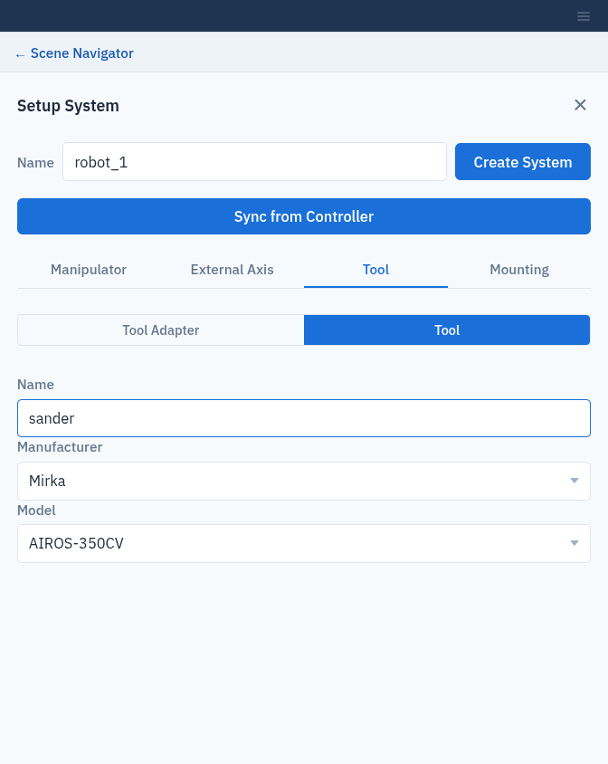
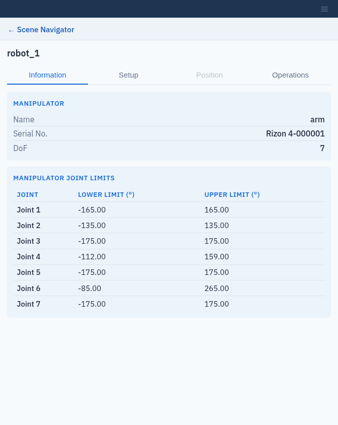

Systems
=======

A **system** is one robot setup: a manipulator, plus optionally an external
axis, a tool adapter and a tool, mounted somewhere in the workcell. Each system
has its own targets and trajectories.

Add a system
------------

Click **+** next to **Systems**. The **Setup System** form opens. Enter the
system **Name** at the top, fill in the tabs below, and click **Create
System**.

.. list-table::
   :header-rows: 1
   :widths: 25 75

   * - Tab
     - Fields
   * - **Manipulator**
     - **Name** of the arm within the system, **Arm Serial Number** and
       **Control Box Serial Number**.
   * - **External Axis**
     - **Name**, **Manufacturer** and **Model** of a linear rail or other
       external axis. Optional.
   * - **Tool** → **Tool Adapter**
     - **Name**, **Manufacturer** and **Model** of the adapter between flange
       and tool. Optional.
   * - **Tool** → **Tool**
     - **Name**, **Manufacturer** and **Model** of the tool. Optional.
   * - **Mounting** → **System Mount**
     - Position (m) and orientation (RPY, degrees) of the system in the world
       frame.
   * - **Mounting** → **Manipulator Mount**
     - Position and orientation of the manipulator relative to the system
       mount.

The **Manufacturer** and **Model** lists come from the server's component
catalogue. The **Tool** and **Tool Adapter** lists also include any custom
components you have defined (:doc:`custom_components`); the **External Axis**
list does not. The external axis, tool adapter and tool are only added if you
give them a **Name**.

.. note::

   Composer Studio 1.0.0 added a tool adapter named ``tool_adapter``
   (Manufacturer ``Mirka``, Model ``AIROS-adapter``) to systems saved with no
   tool adapter **Name**. To remove it from such a system, clear the **Name**
   on the **Tool Adapter** tab and click **Modify System**.

Required fields
   **System Name**, the manipulator **Name**, **Arm Serial Number** and
   **Control Box Serial Number**. If any is empty, Composer Studio outlines it
   in red, switches to its tab, and shows **Please fill in the required
   fields:** followed by the missing fields.

Each system name must be unique in the workcell.

.. figure:: _static/images/system_setup.png
   :width: 60%
   :alt: Setup System, Manipulator tab.

   Setup System, Manipulator tab.

   Choosing a sander from the catalogue on the Tool tab.

Sync from Controller
--------------------

If the robot is switched on and reachable on the network, Composer Studio can
read its configuration from the robot controller:

1. Enter the system **Name**.
2. Click **Sync from Controller**.
3. Enter the robot's public serial number when asked (**Please specify the
   public serial number of the robot.**), for example ``Rizon4-062065``.

The form is filled in with the manipulator, tool and other settings reported
by the controller. Check them, then click **Create System**. Syncing reads the
controller only; it does not enable or move the robot.

Edit or delete a system
-----------------------

Select the system in the tree and open its **Setup** tab. Change the fields
and click **Modify System**, or click **Delete System**.

Keep the system **Name** unchanged when you modify a system. Modify System
with a new **Name** does not rename the system: it creates a second system
with the new name and leaves the old one in place. To rename a system, delete
it and create it again.

.. important::

   **Modify System removes all targets and trajectories of that system.**
   Composer Studio asks you to confirm first. Saved poses no longer match the
   modified robot, so they cannot be kept.

System details
--------------

Selecting a system opens these tabs:

.. list-table::
   :header-rows: 1
   :widths: 20 80

   * - Tab
     - Shows
   * - **Information**
     - The manipulator's name, **Serial No.** and **DoF**, the external axis,
       and tables of joint limits: in degrees, or in metres for a linear
       external axis such as a rail.
   * - **Setup**
     - The edit form described above.
   * - **Position**
     - Joint sliders and a Cartesian pose editor. Available once the system is
       connected to a real robot. Preview only: it does not move the live
       robot yet. See :doc:`connect_to_robot`.
   * - **Operations**
     - **Connect to System**. See :doc:`connect_to_robot`.

The dot next to a system in the tree shows whether it is connected.

   The Information tab of a system.
