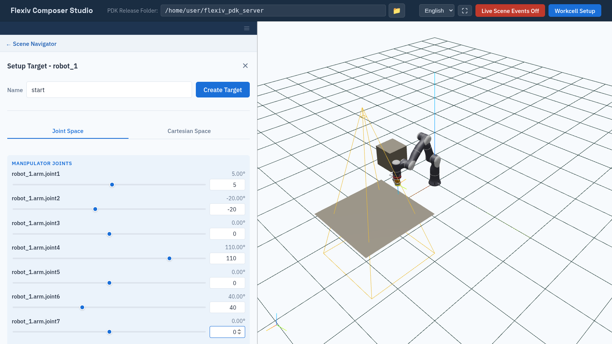
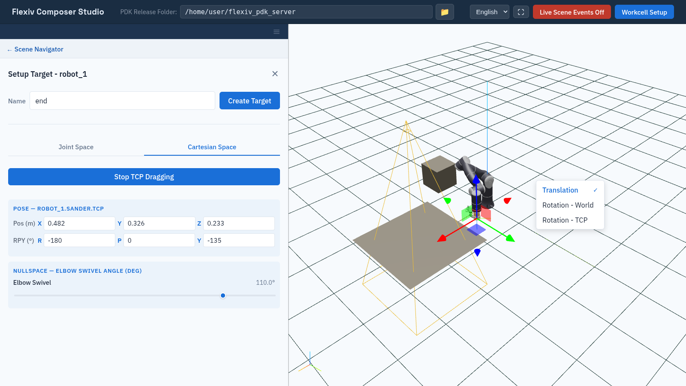

Targets
=======

A **target** is a saved robot pose: the joint angles of a system together with
the matching TCP pose. Targets are the waypoints of PTP trajectories
(:doc:`ptp_trajectories`).

Posing the robot here changes only the 3D model. It never moves a real robot.

Create a target
---------------

1. In the tree, expand a system and click **+** next to **Targets**. The
   **Setup Target** form opens with the robot at its current pose.
2. Enter a **Name**.
3. Pose the robot on either tab, described below.
4. Click **Create Target**.

The target stores the joint angles, the TCP pose in the world frame, and the
TCP pose relative to the robot base. Target names must be unique in the
workcell, across all systems.

Joint Space tab
---------------

One slider per joint, under **Manipulator Joints** and, if the system has one,
**External Axis Joints**. Drag a slider or type a value; the range is the
joint's limits. Rotary joints are in degrees (to 0.01°). A linear joint, such
as a rail, is in metres (to 1 mm), and the robot in the viewport slides along
it.

Shortly after each change, Composer Studio checks the pose against the
``default`` collision configuration (:doc:`collision_configs`). If the robot
collides or the pose is out of reach, it shows an error such as
``Collision check failed: IK computation failed: IK solver failed due to
collision (code: 3)``.

   Posing the robot on the Joint Space tab.

Cartesian Space tab
-------------------

Type the TCP position (m) and orientation (RPY, degrees) in the world frame.
Shortly after each change, Composer Studio solves inverse kinematics (IK) and
moves the robot to match. If there is no solution, it shows **IK failed**
and the robot stays where it was.

Drag the TCP in the viewport
   Click **TCP Dragging**. A handle appears at the TCP; drag it to move the
   robot. Right-click in the viewport to choose what the handle does:

   * **Translation**: move along the world axes.
   * **Rotation - World**: rotate about the world axes.
   * **Rotation - TCP**: rotate about the TCP's own axes.

   If a drag step has no IK solution, the robot stays at the last reachable
   pose. Click **Stop TCP Dragging** when done.

   Dragging the TCP. The right-click menu chooses the drag mode.

Elbow and external axis
   A 7-axis arm can reach the same TCP pose with its elbow in different
   places. Under **Nullspace — elbow swivel angle (deg)**, the **Elbow
   Swivel** slider picks the elbow position used by IK.

   For a system with an external axis, **External Axis Joint Values** sets
   the axis position used by IK, in degrees, or metres for a linear axis:

   * **Preferred** (default): IK starts from these values but may move the
     axis.
   * **Preset**: IK keeps the axis at exactly these values.

View a target
-------------

Select a target in the tree. The robot in the viewport moves to it, and
**Information** lists its system, TCP, joint angles and Cartesian pose. To
delete it, click **×** next to it in the tree.
