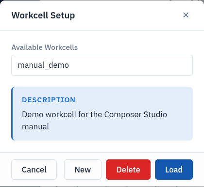
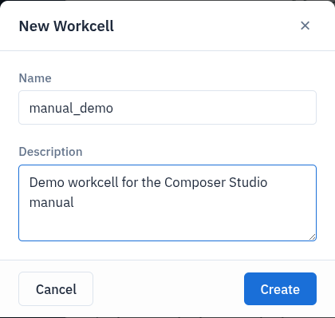

Workcells
=========

All scene data lives in a **workcell**: systems, cameras, objects, areas,
paths, targets and trajectories. The server keeps any number of workcells, and
one of them is *active*. Composer Studio shows nothing until you load a
workcell: at startup the viewport and tree are empty and the **+** buttons are
disabled. Load a workcell with **Workcell Setup** → **Load**.

Workcells are saved as you go. There is no Save, Import or Export: each change
is stored on the server as soon as you confirm it.

Workcell Setup dialog
---------------------

Click **Workcell Setup** in the header bar. The dialog lists **Available
Workcells** and shows the **Description** of the selected one. If the PDK
Release Folder does not exist, the dialog does not open; Composer Studio shows
an error instead (see `Choosing the PDK Release Folder`_).

.. list-table::
   :header-rows: 1
   :widths: 20 80

   * - Button
     - Action
   * - **New**
     - Create a workcell. Enter a **Name** and an optional **Description**,
       then click **Create**. The new workcell is selected but not loaded.
   * - **Load**
     - Make the selected workcell active and show it.
   * - **Delete**
     - Delete the selected workcell after confirming. This cannot be undone.
   * - **Cancel**
     - Close the dialog.

   The Workcell Setup dialog.

   Creating a workcell with New.

What loading shows
------------------

**Load** clears the viewport, then shows the workcell's systems, scene
objects, areas, cameras, paths, targets, PTP trajectories and linear path
trajectories. Objects and cameras attached to a robot flange follow that
robot.

Loading a workcell disconnects every connected robot (:doc:`connect_to_robot`).

Choosing the PDK Release Folder
-------------------------------

The **PDK Release Folder** tells Composer Studio where the workcell files are
(:doc:`launch_composer_studio`). To browse for it, click the folder button next
to **PDK Release Folder:**:

1. The **Select Folder** dialog lists the sub-folders of the current path.
   Click a folder to open it, or click **↑** to go up.
2. Click **Select This Folder**. The folder is applied immediately.

Files in the release folder
---------------------------

Composer Studio keeps some workcell files next to the server's, under
``workcell/<workcell name>/`` in the PDK Release Folder:

.. list-table::
   :header-rows: 1
   :widths: 40 60

   * - Path
     - Holds
   * - ``scene/assets/``
     - Imported ``.obj`` and ``.mtl`` mesh files.
   * - ``areas/`` and ``areas/assets/``
     - Areas and their meshes.
   * - ``scene/objects.urdf``
     - The server's model of the scene objects, read when a workcell is
       loaded.
   * - ``generated_meshes/``
     - Output of the mesh filter and of area extraction, before it is moved
       into ``scene/assets/`` or ``areas/assets/``.
   * - ``point_to_point_path/``
     - Motion profiles of PTP trajectories.
   * - ``systems/<system>/``
     - Robot models (URDF) of each system.
   * - ``*_modified.urdf``
     - Copies of the robot and scene URDFs with server paths changed to local
       paths. Composer Studio writes them next to the originals on each load.

Custom tools and tool adapters are stored in ``custom_components/`` at the top
of the release folder.

.. note::

   Deleting a scene object or replacing it with a filtered mesh deletes its
   mesh files from ``scene/assets/``. Keep your own copy of any mesh you
   import.
